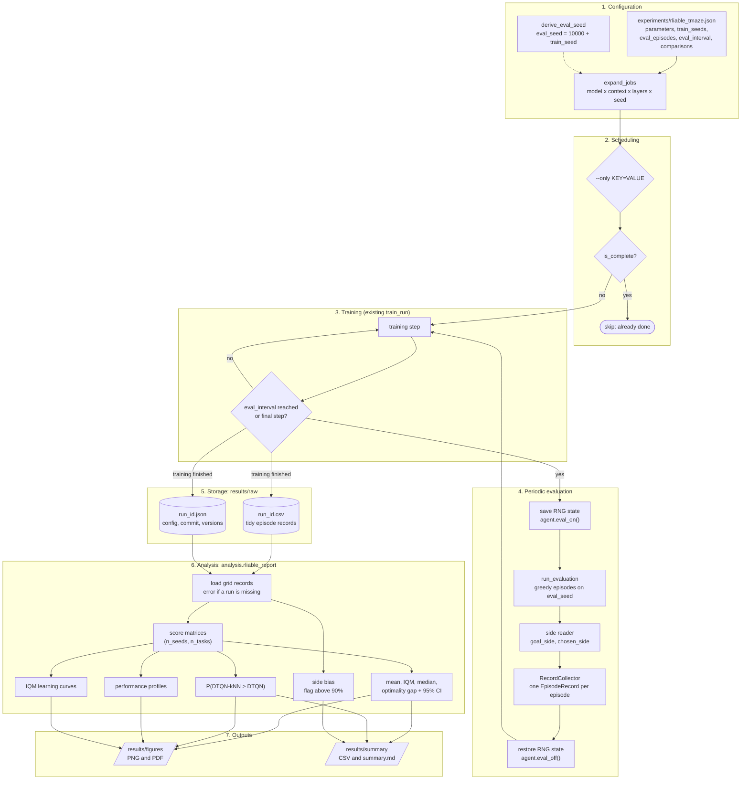
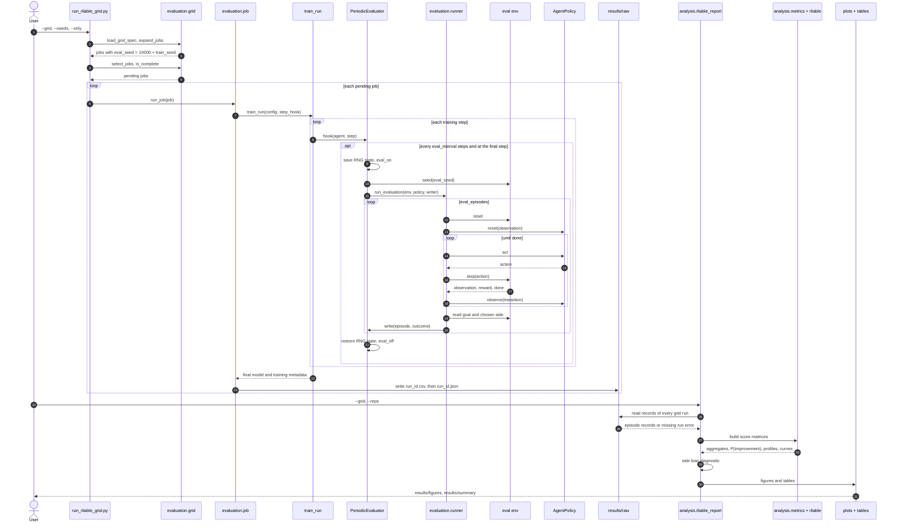

# Multi-seed evaluation pipeline

How [`run_rliable_grid.py`](../run_rliable_grid.py) trains and evaluates a grid,
and how [`analysis/rliable_report.py`](../analysis/rliable_report.py) turns the
saved records into rliable metrics. Commands, options and how to read the results
are in the [README](../README.md#multi-seed-evaluation-with-rliable).

## Modules

| Module | Responsibility |
|---|---|
| [`evaluation/grid.py`](../evaluation/grid.py) | Reads the grid JSON, expands (configuration, training seed) jobs, derives `eval_seed = 10000 + train_seed`, filters jobs and checks which are complete |
| [`evaluation/router.py`](../evaluation/router.py) | Decides the execution plan: device (`--device auto` picks CUDA when available), worker count (`--workers auto` calibrates) and mode (one worker is sequential, more are parallel). It never creates CUDA tensors |
| [`evaluation/execution.py`](../evaluation/execution.py) | `ExecutionPlan`, the executors behind one interface (in-process for sequential, spawned processes for parallel), the `EXECUTORS` registry and the single failure-handling loop |
| [`evaluation/calibration.py`](../evaluation/calibration.py) | `--workers auto`: times short probe runs with 1, 2, 4 and 8 workers in worker processes and picks the fastest count that still pays off |
| [`evaluation/job.py`](../evaluation/job.py) | Runs one job: `train_run` with a step hook that evaluates periodically, then writes the records and metadata |
| [`evaluation/runner.py`](../evaluation/runner.py) | Runs greedy episodes against any policy with `reset`/`act`/`observe`; knows nothing about training |
| [`evaluation/sides.py`](../evaluation/sides.py) | Registry of junction-side readers per environment |
| [`evaluation/records.py`](../evaluation/records.py) | `EpisodeRecord` and the tidy CSV format |
| [`analysis/metrics.py`](../analysis/metrics.py) | `(n_seeds, n_tasks)` score matrices and rliable interval estimates |
| [`analysis/diagnostics.py`](../analysis/diagnostics.py) | Fixed-side policy detection |
| [`analysis/plots.py`](../analysis/plots.py), [`analysis/tables.py`](../analysis/tables.py) | Figures and CSV/Markdown tables from precomputed estimates |
| [`analysis/rliable_report.py`](../analysis/rliable_report.py) | Orchestrates the report |

The parent process must not open a CUDA context before parallel workers start:
on the tested driver, workers on the same GPU then fail with
`CUDA error: out of memory` even with free memory. The router only calls
`torch.cuda.is_available()`, which is safe, and calibration runs every probe in a
worker process, even with one worker.

Add an execution mode by registering its executor factory in `EXECUTORS`; an
executor only yields `(job, error)` pairs, and `run_tasks` handles logging and
failures for every mode.

Training reuses [`utils/experiment.py`](../utils/experiment.py) unchanged except
for an optional `step_hook`, called after every training interaction. Evaluation
saves and restores the Python, NumPy, PyTorch and agent random states, so the
trained weights match a run without evaluation (covered by
`tests/test_evaluation_protocol.py`).

## Flow

## Sequence

